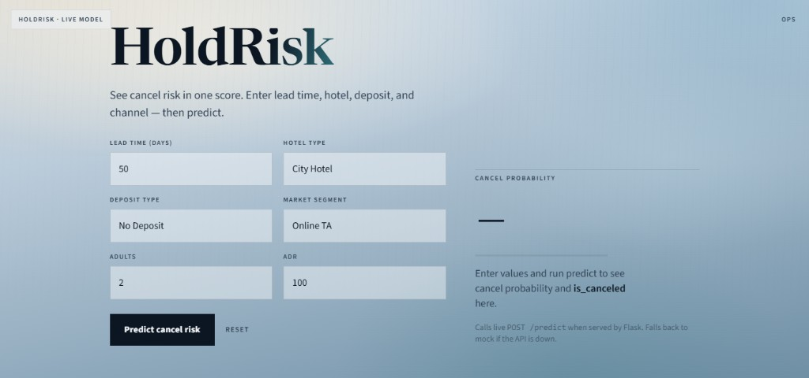
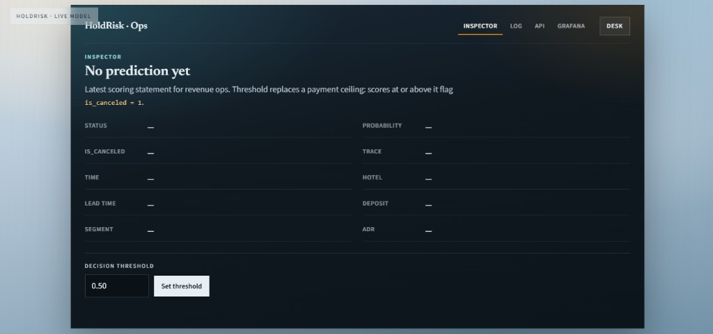

# Hotel Booking Cancellation

**HoldRisk** — one cancel-risk score for a hotel reservation, so revenue and the front desk can plan overbooking and staffing with less guesswork.

Built as a midterm project for [Machine Learning Zoomcamp 2026](https://github.com/DataTalksClub/machine-learning-zoomcamp).

**Live app:** https://hotel-cancel-api.onrender.com

## Table of contents

- [Problem](#problem)
- [How to run](#how-to-run)
- [Cloud deployment](#cloud-deployment)
- [Architecture](#architecture)
- [Project structure](#project-structure)
- [Screenshots](#screenshots)
- [Evaluation criteria](#evaluation-criteria)
- [License](#license)

---

## Problem

Hotels take reservations that guests may cancel. A late cancel leaves an empty room and a staffing plan built for a guest who never arrives. HoldRisk scores one booking as a cancel probability and a yes/no flag (`is_canceled`) so operations can decide which reservations need a closer look.

The product is the **cancel-risk service**. It is not a booking website. A desk form sends the booking fields to `POST /predict`. The same process serves an in-app Ops board (request rate, latency, and the audit stream). That board is not a separate Grafana server.

The target is binary `is_canceled` on [hotel-booking-demand](https://www.kaggle.com/datasets/jessemostipak/hotel-booking-demand) (Antonio, Almeida, and Nunes). Training compares logistic regression, a random forest, and XGBoost on one seeded split, then exports the chosen pipeline to `src/train.py` and serves it from Docker.

Out of scope: car price, telco churn, credit risk, and clothing datasets.

[↑ Contents](#table-of-contents)

---

## How to run

Install from `requirements.txt`. `pyproject.toml` is not the install source. The CSV is gitignored. `models/model.bin` is tracked so the API can start without a local retrain.

Seeds: `train_test_split(..., random_state=42)` and XGBoost `params["seed"]=42`.

```powershell
. E:\IT_SPACES\AI\scripts\use_e_drive.ps1
cd E:\IT_SPACES\AI\Projects\ml\hotel-booking-cancellation
.\.venv\Scripts\Activate.ps1
pip install -r requirements.txt

# 1) Data — see data/README.md
#    Expected: data/hotel_bookings.csv

# 2) Train (writes models/model.bin)
python src/train.py

# 3) Notebook (EDA + model selection): notebooks/notebook.ipynb

# 4) Local API
python src/predict.py

# 5) Docker (one command pair)
docker build -t hotel-cancel . ; docker run --rm -p 9696:9696 hotel-cancel
```

`scripts/use_e_drive.ps1` is optional. It keeps caches on the author's `E:` drive. Skip it if you use the default cache locations. Replace the `cd` path with your own clone.

Open http://localhost:9696/ for the desk. Health: `GET /health`. Predict: `POST /predict`. Ops board: `GET /ops/board`.

[↑ Contents](#table-of-contents)

---

## Cloud deployment

**Live URL:** https://hotel-cancel-api.onrender.com  
The free plan may cold-start for 30–60 seconds on the first request.

The HoldRisk desk is `GET /`. Ops is the top-right control (Inspector / Log / API / Grafana). The Grafana tab reads `GET /ops/board` from this process.

```powershell
$base = "https://hotel-cancel-api.onrender.com"
$body = @{
  hotel = "City Hotel"; lead_time = 50
  arrival_date_year = 2017; arrival_date_month = "July"
  arrival_date_week_number = 27; arrival_date_day_of_month = 1
  stays_in_weekend_nights = 1; stays_in_week_nights = 2
  adults = 2; children = 0; babies = 0; meal = "BB"; country = "PRT"
  market_segment = "Online TA"; distribution_channel = "TA/TO"
  is_repeated_guest = 0; previous_cancellations = 0
  previous_bookings_not_canceled = 0
  reserved_room_type = "A"; assigned_room_type = "A"
  booking_changes = 0; deposit_type = "No Deposit"
  agent = "9"; company = "missing"; days_in_waiting_list = 0
  customer_type = "Transient"; adr = 100.0
  required_car_parking_spaces = 0; total_of_special_requests = 1
} | ConvertTo-Json
Invoke-RestMethod -Method Post -Uri "$base/predict" `
  -ContentType "application/json" -Body $body
```

Deploy notes: [`deploy/README.md`](deploy/README.md). Blueprint: [`render.yaml`](render.yaml).

[↑ Contents](#table-of-contents)

---

## Architecture

1. `scripts/phase1_eda.py` and `notebooks/notebook.ipynb` load the table, record missing values and the target rate (~37% canceled), mark leakage columns, and split with seed 42. No model is fit there.
2. `scripts/phase2_models.py` compares logistic regression, a random forest, and XGBoost on the same split. XGBoost wins, with validation ROC-AUC about 0.95.
3. `src/train.py` refits that pipeline and writes `models/model.bin` (DictVectorizer + booster).
4. `src/predict.py` loads that file and serves the desk, `POST /predict`, and the in-app Ops board with Flask on port 9696.
5. `Dockerfile` runs that process. The live service returned `cancel_probability≈0.6116`, `is_canceled=true` on 2026-11-10.

Leakage columns left out of training: `reservation_status`, `reservation_status_date`.

[↑ Contents](#table-of-contents)

---

## Project structure

```text
data/            download instructions; CSV is gitignored
notebooks/       EDA and model-selection notebook
scripts/         phase1_eda.py, phase2_models.py
src/train.py     final training script → models/model.bin
src/predict.py   Flask desk, POST /predict, GET /ops/board
ui_dummy/        HoldRisk desk and Ops UI
Dockerfile       image for the predict API
render.yaml      Render Blueprint
deploy/          cloud notes
_planning/       roadmap, checkpoints, phase notes
```

[↑ Contents](#table-of-contents)

---

## Screenshots

Desk before a prediction:



Ops Inspector on the same host, before any score:



[↑ Contents](#table-of-contents)

---

## Evaluation criteria

Scores use the official Zoomcamp rubric only. A row stays at 0 until the evidence exists. Working copy: [`_planning/CHECKPOINTS.md`](_planning/CHECKPOINTS.md).

| # | Criterion | Max | Score | Evidence |
|---|-----------|----:|------:|----------|
| 1 | Problem description | 2 | 2 | [Problem](#problem): who uses the score, what `is_canceled` is, and what is out of scope |
| 2 | EDA | 2 | 2 | notebook + `scripts/phase1_eda.py` (load, missing, target, leakage memo, seeded split) |
| 3 | Model training | 3 | 3 | `scripts/phase2_models.py` — logistic regression, random forest, XGBoost; winner XGBoost, AUC about 0.95 |
| 4 | Export notebook to script | 1 | 1 | `src/train.py` → `models/model.bin` |
| 5 | Reproducibility | 1 | 1 | [How to run](#how-to-run) + `data/README.md` + seed 42; `python src/train.py` OK (2026-11-09) |
| 6 | Model deployment | 1 | 1 | Flask `POST /predict`; one local JSON response OK |
| 7 | Dependency / environment | 2 | 2 | `requirements.txt` pins + install steps above |
| 8 | Containerization | 2 | 2 | `docker build -t hotel-cancel .` and `docker run -p 9696:9696`; `POST /predict` OK |
| 9 | Cloud deployment (bonus) | 2 | 2 | Live https://hotel-cancel-api.onrender.com — `POST /predict` → `cancel_probability≈0.6116`, `is_canceled=true` |
| — | **Subtotal** | **16** | **16** | |
| 10 | Peer reviews (extra) | 3 | 0 | after 3 peer reviews |

Official criteria: [ML Zoomcamp projects README](https://github.com/DataTalksClub/machine-learning-zoomcamp/blob/main/projects/README.md).

[↑ Contents](#table-of-contents)

---

## License

The dataset is third-party (Kaggle / the original paper authors). Follow their license. Code in this repository is released for the course submission.

[↑ Contents](#table-of-contents)
